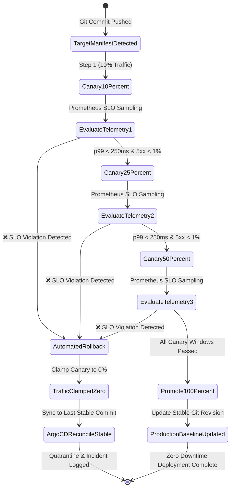

# Autonomous GitOps Continuous Verification & Automated Rollback Controller

[](https://github.com/KoshaG0hil/Autonomous-GitOps-Continuous-Verification-Controller/actions)
[](https://argo-cd.readthedocs.io/)
[](#slo-verification-gates)
[](#autonomous-state-machine)
[](LICENSE)
[](https://www.python.org/)

An enterprise-grade **Autonomous Continuous Verification and Automated Rollback Controller** designed for **Kubernetes GitOps (ArgoCD)** and **Crossplane Cloud Infrastructure**.

Traditional GitOps deploys manifests automatically upon Git push, but lacks runtime health awareness—leading to silent outages when broken code passes unit tests but causes p99 latency regressions or burns error budgets under production traffic. This controller continuously monitors Prometheus telemetry during progressive canary deployment windows, statistically validates real-time SLOs, and autonomously executes instantaneous traffic isolation and Git rollback upon SLO violation.

---

## 🏛️ Autonomous State Machine Architecture



---

## 🎯 Continuous Verification SLO Gates

During every progressive shift (10% -> 25% -> 50% -> 100%), the controller evaluates four critical production dimensions:

| Dimension | Prometheus Metric | Default Threshold | Breach Action |
| :--- | :--- | :--- | :--- |
| **p99 Latency** | `histogram_quantile(0.99, rate(http_request_duration_seconds_bucket[2m]))` | `<= 250ms` | Instant 0% traffic cut & Git rollback |
| **p95 Latency** | `histogram_quantile(0.95, rate(http_request_duration_seconds_bucket[2m]))` | `<= 120ms` | Instant 0% traffic cut & Git rollback |
| **Error Budget** | `sum(rate(http_requests_total{status=~"5.."}[2m])) / sum(...) * 100` | `<= 1.0%` | Instant 0% traffic cut & Git rollback |
| **Throughput** | `sum(rate(http_requests_total[2m]))` | `>= 10.0 RPS` | Prevents false positives under zero traffic |

---

## 📂 Project Structure

```text
Autonomous-GitOps-Continuous-Verification-Controller/
├── .github/
│   └── workflows/
│       └── ci.yml                     # Automated Pytest & rollout verification CI
├── src/
│   ├── __init__.py
│   └── controller/
│       ├── __init__.py
│       ├── models.py                  # CanaryPhase, SLOThresholds, MetricSample models
│       ├── metric_evaluator.py        # Real-time Prometheus SLO gate evaluator
│       ├── gitops_reconciler.py       # ArgoCD Application & Crossplane state engine
│       ├── canary_controller.py       # Continuous verification progressive rollout controller
│       └── audit_logger.py            # Structured JSON & Markdown audit summary engine
├── k8s/
│   ├── crd-continuous-verification.yaml # Kubernetes CRD ContinuousVerificationAnalysis
│   ├── argocd-application.yaml        # Production ArgoCD Application manifest
│   └── crossplane-composite.yaml      # Crossplane XRD & Composition infrastructure specs
├── tests/
│   ├── conftest.py                    # Pytest configuration
│   └── test_controller.py             # 11 unit & integration tests
├── cli.py                             # Interactive CLI runner
├── requirements.txt                   # Pytest, PyYAML dependencies
├── LICENSE                            # MIT License
└── README.md                          # Architectural & user guide
```

---

## 🚀 Quickstart & CLI Usage

### 1. Installation
```bash
git clone https://github.com/KoshaG0hil/Autonomous-GitOps-Continuous-Verification-Controller.git
cd Autonomous-GitOps-Continuous-Verification-Controller
pip install -r requirements.txt
```

### 2. Simulate Healthy Canary Deployment (Promotion Path)
```bash
python cli.py simulate --mode healthy
```
*Output:*
```text
=================================================================
 [GitOps Controller] Autonomous Continuous Verification Cycle
=================================================================
[*] Simulating HEALTHY Canary Rollout (10% -> 25% -> 50% -> 100%)...

[PASSED] Step 1 (step1-10pct)
         p95: 45.0ms | p99: 95.0ms | 5xx: 0.05%
[PASSED] Step 2 (step2-25pct)
         p95: 52.0ms | p99: 110.0ms | 5xx: 0.08%
[PASSED] Step 3 (step3-50pct)
         p95: 58.0ms | p99: 125.0ms | 5xx: 0.10%
[PASSED] Step 4 (step4-100pct)
         p95: 64.0ms | p99: 140.0ms | 5xx: 0.12%

-----------------------------------------------------------------
Final Deployment Phase : PROMOTED_100
Application Status     : Healthy
Active Git Revision    : v2.1.0-canary
Canary Traffic Weight  : 100%

[+] SUCCESS: Deployment passed all continuous verification gates and was promoted.
```

### 3. Simulate Degraded Deployment (Automated Rollback Path)
```bash
python cli.py simulate --mode degraded
```
*Output:*
```text
=================================================================
 [GitOps Controller] Autonomous Continuous Verification Cycle
=================================================================
[*] Simulating DEGRADED Canary Rollout (Failure injection at Step 3)...

[PASSED] Step 1 (step1-10pct)
         p95: 45.0ms | p99: 95.0ms | 5xx: 0.05%
[PASSED] Step 2 (step2-25pct)
         p95: 52.0ms | p99: 110.0ms | 5xx: 0.08%
[BREACH] Step 3 (step3-50pct-breach)
         p95: 280.0ms | p99: 480.0ms | 5xx: 3.80%
         Decision: ROLLING_BACK | Reason: SLO gate violation detected. Triggering immediate automated rollback.

-----------------------------------------------------------------
Final Deployment Phase : ROLLED_BACK
Application Status     : Healthy (Rolled Back)
Active Git Revision    : v2.0.0
Canary Traffic Weight  : 0%

[+] SUCCESS: Autonomous controller safely intercepted failure and executed automated rollback.
```

### 4. Evaluate Telemetry Sample Against Custom SLOs
```bash
python cli.py verify --p95 85.0 --p99 220.0 --error-rate 0.4 --rps 180.0
```

### 5. Inspect Controller & Reconciler Status
```bash
python cli.py status
```

---

## 🧪 Verification & Test Results

```bash
pytest tests -v
```
```text
Autonomous-GitOps-Continuous-Verification-Controller/tests/test_controller.py::test_metric_evaluator_all_pass PASSED
Autonomous-GitOps-Continuous-Verification-Controller/tests/test_controller.py::test_metric_evaluator_p99_latency_breach PASSED
Autonomous-GitOps-Continuous-Verification-Controller/tests/test_controller.py::test_metric_evaluator_p95_latency_breach PASSED
Autonomous-GitOps-Continuous-Verification-Controller/tests/test_controller.py::test_metric_evaluator_error_rate_breach PASSED
Autonomous-GitOps-Continuous-Verification-Controller/tests/test_controller.py::test_metric_evaluator_insufficient_load PASSED
Autonomous-GitOps-Continuous-Verification-Controller/tests/test_controller.py::test_gitops_reconciler_traffic_shifting PASSED
Autonomous-GitOps-Continuous-Verification-Controller/tests/test_controller.py::test_gitops_reconciler_automated_rollback PASSED
Autonomous-GitOps-Continuous-Verification-Controller/tests/test_controller.py::test_gitops_reconciler_promotion PASSED
Autonomous-GitOps-Continuous-Verification-Controller/tests/test_controller.py::test_canary_controller_healthy_progression PASSED
Autonomous-GitOps-Continuous-Verification-Controller/tests/test_controller.py::test_canary_controller_degraded_automated_rollback PASSED
Autonomous-GitOps-Continuous-Verification-Controller/tests/test_controller.py::test_audit_logger_render PASSED

============================= 11 passed in 0.09s ==============================
```

---

## 📜 License

Distributed under the MIT License. See [LICENSE](LICENSE) for details.

Developed with ❤️ by **Kosha Gohil** — Senior Cloud Security & DevSecOps Engineer.
